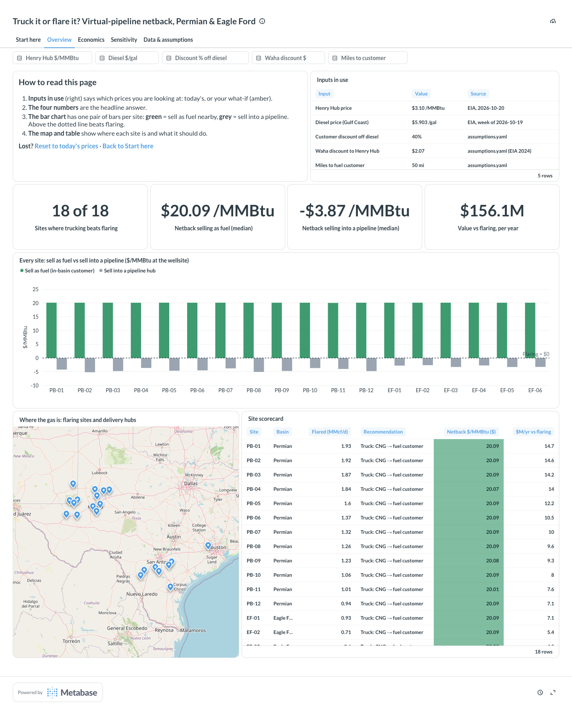
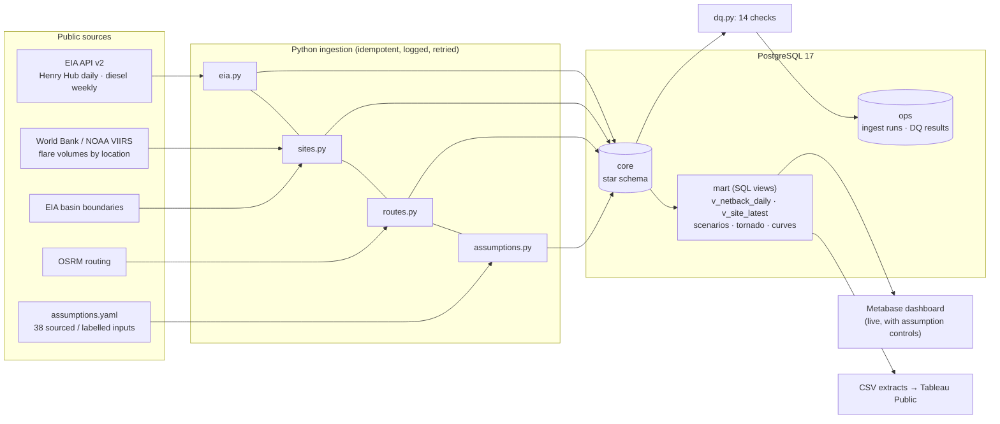
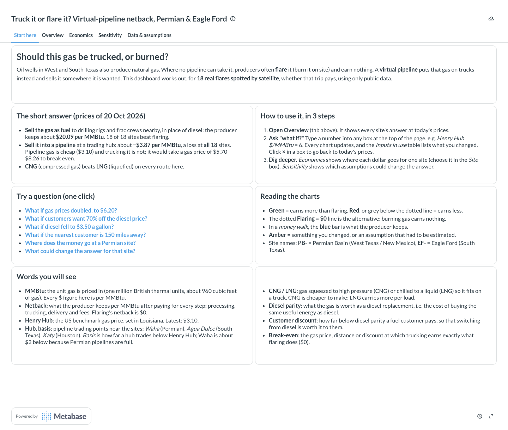
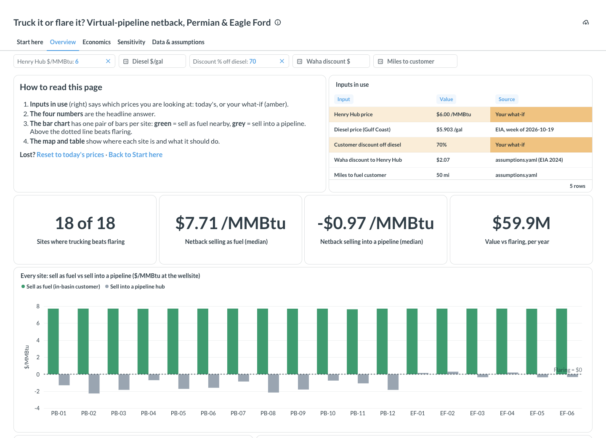
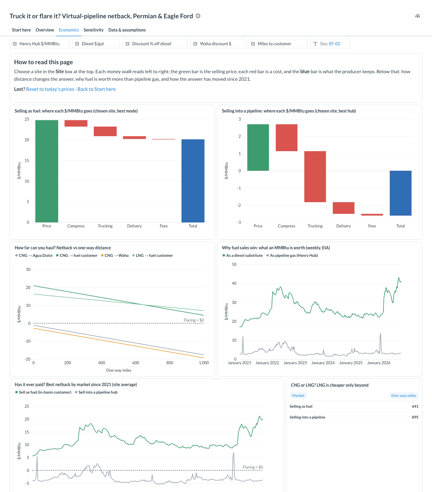
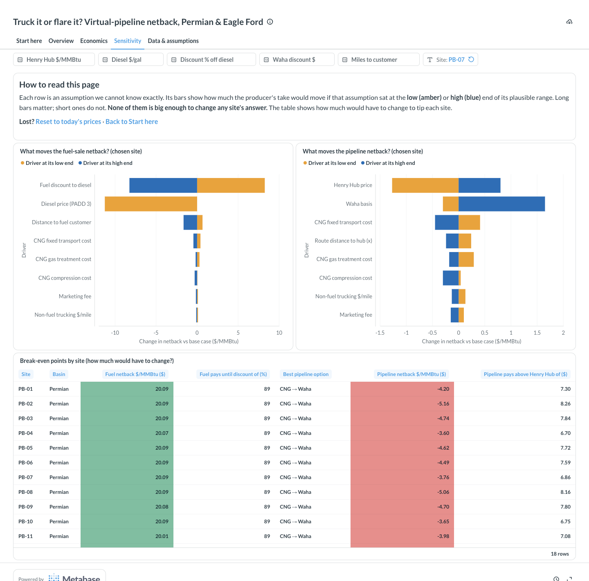

# Virtual Pipeline Netback

**Should a producer with stranded gas truck it as CNG or LNG, or keep flaring it?** This
project answers that every trading day for 18 real, satellite-detected flares in the Permian and
Eagle Ford. It uses only public data: EIA prices, World Bank/NOAA VIIRS flare detections, EIA
basin boundaries and OSRM road routing. A Postgres star schema, idempotent ingestion with
data-quality checks, a netback model written in readable SQL, a sensitivity analysis and a
dashboard with assumption controls sit on top.

**▶ Live dashboard: [kaavinb.github.io/virtual-pipeline-netback](https://kaavinb.github.io/virtual-pipeline-netback/)**:
no install, works on a phone. Drag the sliders to ask "what if?"; every view is a shareable link.



## Findings (prices as of 2026-10-20: Henry Hub $3.10/MMBtu, Gulf Coast diesel $5.90/gal)

1. **Selling trucked gas into a pipeline loses money at every site:** −$2.60 to −$5.16/MMBtu.
   Henry Hub would need to be **$5.70–$8.26** to break even. Permian sites fare worst, because their
   only nearby hub, Waha, trades about $2 below Henry Hub. Since 2010, hub sales beat flaring on
   most Eagle Ford days only once: in 2022, when Henry Hub averaged $6.45.
2. **Selling the same gas as a diesel substitute to an in-basin customer** (rig, frac fleet,
   off-grid power) **nets about +$20/MMBtu at every site.** That conclusion holds even though the
   customer discount is a guess: flaring only wins if the customer demands **more than ~89% off
   diesel parity**. The real constraint is finding demand, not price.
3. **CNG beats LNG at every site.** On a road chassis an LNG ISO tank hits the 80,000 lb limit at
   about 69% full, so LNG's energy-per-load advantage shrinks to 1.8×. Small-scale liquefaction then
   costs about $7/MMBtu, so LNG only becomes cheaper than CNG beyond **641 mi** (fuel sales) or
   **895 mi** (hub sales). Every route here is under 600 mi.
4. **No single input flips any decision.** 25 drivers × 18 sites × 2 markets were swung across
   their sourced or data-driven ranges ([08](docs/08-sensitivity.md)).

The bottom-up cost model reproduces the World Bank's independent full-chain estimates within
3–9% ([06](docs/06-cost-model.md#calibration-against-an-independent-benchmark)).

## Why this matters to a virtual-pipeline company

A virtual pipeline (CNG/LNG in ISO containers on trucks) earns its keep where pipelines don't
reach. The questions a commercial or BI team asks every day are the ones this model answers:
- Which sites and delivery points net the most per MMBtu?
- How far can we haul before it stops paying?
- When does LNG beat CNG?
- How exposed is each answer to gas, basis and diesel prices?

The pipeline-versus-fuel result is the strategic point: **the value sits in delivered-fuel
markets, not pipeline injection**, and distance only matters at the margin.

## How it works



**Netback** = delivered price − (treatment + compression or liquefaction) − trucking −
(decompression or regas) − fees, all in $/MMBtu at the wellsite. Trucking is built bottom-up:

```
trucking $/MMBtu = fixed + 2 × (road miles + last mile) × (diesel $/gal ÷ mpg + non-fuel $/mile) ÷ MMBtu per load
```

MMBtu per load is **computed**: the smaller of what the container holds and what is legal at
80,000 lb. Delivered price is Henry Hub + basis for hubs, or diesel parity × (1 − discount) for a
fuel customer. Diesel parity is taken on a **lower-heating-value** basis: engines burn on LHV,
gas is sold on HHV, and skipping the correction overstates the gas value by 3.3%. The full walk-through is in
[01 — value chain and netback](docs/01-value-chain-and-netback.md).

**All business logic is SQL** ([sql/migrations](sql/migrations)). Python only moves data in and
out. What-if analysis never copies the formulas: `mart.site_latest_scenario('{"fuel_discount_to_diesel": 0.6}')`
sets a transaction-local override that `mart.v_assumption` honours, and then the *same* views
recompute. The sensitivity tornado and the dashboard's controls both run through it.

## Run it

Requirements: Docker, [uv](https://docs.astral.sh/uv/), make, and a free
[EIA API key](https://www.eia.gov/opendata/register.php).

```bash
cp .env.example .env        # paste EIA_API_KEY, choose a Metabase admin password
make setup                  # Python 3.12 deps via uv
make all                    # Postgres → migrations → EIA → sites → assumptions → routes → DQ → sensitivity → CSV extracts (~90 s)
make dashboard              # Metabase on http://localhost:3000, dashboard built from code
make test                   # 70 tests
```

`make help` lists every target. `make reset && make all` rebuilds from an empty database
deterministically: the same 18 sites, and identical numbers for the same
source data.

## Data sources

| Data | Source | Notes |
|---|---|---|
| Henry Hub daily spot | [EIA API v2](https://www.eia.gov/opendata/documentation.php) `natural-gas/pri/fut`, series `RNGWHHD` | 4,242 days since 2010 |
| No. 2 diesel retail, weekly | EIA API v2 `petroleum/pri/gnd`, `EMD_EPD2D_PTE_R30_DPG` (Gulf Coast / PADD 3) and `…_NUS_DPG` (US) | TX and NM are in PADD 3 |
| Flare locations & volumes | [World Bank GFMR, 2012–2025 flare-level estimates](https://www.worldbank.org/en/programs/gasflaringreduction/global-flaring-data) (NOAA VIIRS, Payne Institute) | operator names deliberately not loaded |
| Basin outlines | [EIA ArcGIS services](https://services7.arcgis.com/FGr1D95XCGALKXqM/ArcGIS/rest/services): Permian basin, Eagle Ford play | point-in-polygon |
| Road distance, time, geometry | [OSRM](https://github.com/Project-OSRM/osrm-backend/wiki/Demo-server) demo server (≤1 req/s, cached) | local OSRM fallback: `make osrm-local` |
| Costs, payloads, constants | EIA, DOE AFDC, ATRI, FHWA/23 CFR 658, Hexagon, OEG, World Bank GGFR, BLS CPI | see [02](docs/02-data-sources.md) |
| **Regional hub prices (Waha, Katy, Agua Dulce)** | **not publicly available**: licensed (NGI/Platts) | modelled as Henry Hub + basis assumption |

Every endpoint and series ID was called and checked before any code was written against it;
the record is in [02 — data sources](docs/02-data-sources.md).

## Assumptions

Every number that isn't an observed price lives in [`assumptions.yaml`](assumptions.yaml), and
each one is labelled **sourced**, **derived** or **rough estimate**. The loader rejects a sourced
number without a URL, or a value outside its own sensitivity range. 2015-dollar World Bank costs
are converted to 2025 dollars in SQL using BLS CPI-U (×1.358).

<details>
<summary>Full assumptions table (38 entries, generated from the YAML)</summary>

| Assumption | Value | Range (sensitivity) | Unit | Basis | Source |
|---|---|---|---|---|---|
| `basis_waha` | -2.07 | -2.37 – -0.42 | usd_per_mmbtu | sourced | [EIA Today in Energy, 2024-09-10: Waha averaged $2.07/MMBtu below Henry Hub in 2024 to date (NGI data)](https://www.eia.gov/todayinenergy/detail.php?id=63044) |
| `basis_agua_dulce` | -0.4 | -0.6 – -0.2 | usd_per_mmbtu | **rough estimate** | [No public daily series. NGI trade press (paywalled, unverified) reports Agua Dulce 25-49 cents under Henry Hub in 2025-26 spot and forward markets.](https://www.naturalgasintel.com/services/ngi-price-index-data/) |
| `basis_katy` | -0.3 | -1 – -0.1 | usd_per_mmbtu | **rough estimate** | [No public daily series. Trade press (unverified): Katy usually under $0.20 below Henry Hub, about $1 below during the 2022-23 Freeport LNG outage, ~47 cents below in winter 2026/27 forwards.](https://www.ice.com/products/59293792/Katy-Basis-Future) |
| `gas_mmbtu_per_mcf` | 1.037 |  | mmbtu_per_mcf | sourced | [EIA FAQ 45: 2025 average heat content of natural gas delivered to end users, 1,037 Btu/cf](https://www.eia.gov/tools/faqs/faq.php?id=45&t=8) |
| `lng_btu_per_lb` | 23726 |  | btu_per_lb | sourced | [DOE AFDC fuel properties: LNG higher heating value](https://afdc.energy.gov/fuels/properties) |
| `lng_lb_per_gal` | 3.5 |  | lb_per_gal | derived | [DOE AFDC: 1 lb LNG = 0.19 GGE and 1 GGE = 1.5 gal LNG, so 1/0.19/1.5 = 3.5 lb/gal](https://afdc.energy.gov/fuels/natural-gas-basics) |
| `gas_lhv_btu_per_lb` | 20160 |  | btu_per_lb | sourced | [DOE AFDC fuel properties: CNG lower heating value](https://afdc.energy.gov/fuels/properties) |
| `gas_hhv_btu_per_lb` | 22453 |  | btu_per_lb | sourced | [DOE AFDC fuel properties: CNG higher heating value. Gas is sold on HHV, engines burn on LHV.](https://afdc.energy.gov/fuels/properties) |
| `diesel_lhv_btu_per_gal` | 128488 |  | btu_per_gal | sourced | [DOE AFDC fuel properties: low-sulfur diesel lower heating value](https://afdc.energy.gov/fuels/properties) |
| `gross_vehicle_weight_limit_lb` | 80000 |  | lb | sourced | [23 CFR 658.17(b): maximum gross vehicle weight 80,000 lb on the Interstate System](https://www.law.cornell.edu/cfr/text/23/658.17) |
| `tractor_and_chassis_lb` | 27000 | 25000 – 30000 | lb | **rough estimate** | Day-cab tractor plus 40 ft container chassis. Consistent with Hexagon selling the TITAN4 (50,024 lb loaded) as US road-legal, which leaves at most 29,976 lb for tractor and chassis. |
| `cng_capacity_scf` | 363148 | 363148 – 492180 | scf | sourced | [Hexagon Agility Mobile Pipeline brochure (2021): TITAN4 40 ft nominal capacity 363,148 scf at 15 C](https://www.cngservices.co.uk/wp-content/uploads/MobilePipleline_ePub_2021_11x8.5_b.pdf) |
| `cng_container_tare_lb` | 33700 |  | lb | sourced | [Hexagon Mobile Pipeline brochure (2021): TITAN4 40 ft net container weight 33,700 lb](https://www.cngservices.co.uk/wp-content/uploads/MobilePipleline_ePub_2021_11x8.5_b.pdf) |
| `cng_lb_per_scf` | 0.04495 |  | lb_per_scf | sourced | [Hexagon Mobile Pipeline brochure (2021): CNG gas weight 0.04495 lb/scf](https://www.cngservices.co.uk/wp-content/uploads/MobilePipleline_ePub_2021_11x8.5_b.pdf) |
| `cng_deliverable_fraction` | 0.9 | 0.85 – 0.96 | fraction | sourced | [World Bank GGFR, CNG for commercialization of small volumes of associated gas (2016): residual gas 10-15% with conventional high-pressure blowdown](https://documents1.worldbank.org/curated/en/210571472125529218/pdf/104200-V2-WP-CNG-commercialization-PUBLIC-Main-report-REPLACEMENT.pdf) |
| `lng_capacity_gal` | 12020 |  | gal | sourced | [OEG cryogenic ISO tank datasheet: 40 ft T75, 12,020 US gal (45,500 L)](https://www.oeg.group/hubfs/data-sheets/OEG-Datasheet-Cryogenic-ISO-tanks.pdf) |
| `lng_max_fill_fraction` | 0.9 |  | fraction | **rough estimate** | Cryogenic tanks keep vapour space for boil-off. Does not bind: at 80,000 lb the load is weight-limited well below this fill. |
| `lng_container_tare_lb` | 26898 |  | lb | sourced | [OEG cryogenic ISO tank datasheet: 40 ft T75 tare 26,898 lb](https://www.oeg.group/hubfs/data-sheets/OEG-Datasheet-Cryogenic-ISO-tanks.pdf) |
| `lng_deliverable_fraction` | 0.98 | 0.95 – 1 | fraction | **rough estimate** | A small liquid heel is usually kept to hold the tank cold for the return trip; boil-off on a same-day haul is small. |
| `truck_mpg` | 6.3 | 5.3 – 7.3 | mi_per_gal | sourced | [DOE AFDC average fuel economy, Class 8 truck: 6.3048 mpg (FHWA Highway Statistics 2024, Table VM-1)](https://afdc.energy.gov/data/10310) |
| `nonfuel_usd_per_mile` | 1.854 | 1.483 – 2.225 | usd_per_mile (2025$) | sourced | [ATRI, An Analysis of the Operational Costs of Trucking (2026, 2025 data): $2.336/mi total, $1.854/mi excluding fuel](https://www.ttnews.com/articles/atri-truck-costs-2025) |
| `last_mile_factor` | 1 | 1 – 1.5 | ratio | **rough estimate** | Multiplier on the straight-line gap between a flare and the nearest mapped road (OSRM snap distance). 1.0 is a lower bound; lease roads wind. |
| `route_distance_factor` | 1 | 0.75 – 1.25 | ratio | **rough estimate** | Multiplier on routed hub miles. Below 1: the gas is delivered to a nearer pipeline interconnect than the named hub; above 1: detours, permitted truck routes. |
| `diesel_region` | PADD3 |  | region_code | sourced | EIA weekly No. 2 diesel retail, Gulf Coast (PADD 3): Texas and New Mexico are both in PADD 3 |
| `cng_gas_treatment` | 0.42 | 0.21 – 0.55 | usd_per_mmbtu (2015$) | sourced | [World Bank GGFR CNG report (2016), onshore truck 3 MMscf/d: gas treatment 0.42 USD2015/MMBtu](https://documents1.worldbank.org/curated/en/210571472125529218/pdf/104200-V2-WP-CNG-commercialization-PUBLIC-Main-report-REPLACEMENT.pdf) |
| `cng_compression` | 0.73 | 0.7 – 0.95 | usd_per_mmbtu (2015$) | sourced | [World Bank GGFR CNG report (2016), onshore truck 3 MMscf/d: compression/loading 0.73 USD2015/MMBtu](https://documents1.worldbank.org/curated/en/210571472125529218/pdf/104200-V2-WP-CNG-commercialization-PUBLIC-Main-report-REPLACEMENT.pdf) |
| `cng_delivery` | 0.5 | 0.5 – 0.65 | usd_per_mmbtu (2015$) | sourced | [World Bank GGFR CNG report (2016): delivery (offloading, heating, let-down, metering) 0.50 USD2015/MMBtu](https://documents1.worldbank.org/curated/en/210571472125529218/pdf/104200-V2-WP-CNG-commercialization-PUBLIC-Main-report-REPLACEMENT.pdf) |
| `cng_fixed_transport` | 1.1 | 0.8 – 1.43 | usd_per_mmbtu (2015$) | derived | [Intercept of GGFR's CNG truck transport cost vs distance: 2.20 at 0-250 mi and 8.81 at 750-1000 mi, so slope 0.00881/mi and intercept 2.20 - 125 x 0.00881 = 1.10 USD2015/MMBtu](https://documents1.worldbank.org/curated/en/210571472125529218/pdf/104200-V2-WP-CNG-commercialization-PUBLIC-Main-report-REPLACEMENT.pdf) |
| `lng_gas_treatment` | 0.42 | 0.21 – 0.55 | usd_per_mmbtu (2015$) | sourced | [World Bank GGFR mini/micro-LNG report (2016), onshore truck 3 MMscf/d: gas treatment 0.42 USD2015/MMBtu](https://documents1.worldbank.org/curated/en/299861484716073109/pdf/112131-WP-MiniMicroLNGforcommercializationofsmallvolumesofassociatedgas-PUBLIC-v2.pdf) |
| `lng_liquefaction` | 4.71 | 3.71 – 6.12 | usd_per_mmbtu (2015$) | sourced | [World Bank GGFR mini/micro-LNG report (2016), onshore truck 3 MMscf/d: liquefaction 4.71 USD2015/MMBtu](https://documents1.worldbank.org/curated/en/299861484716073109/pdf/112131-WP-MiniMicroLNGforcommercializationofsmallvolumesofassociatedgas-PUBLIC-v2.pdf) |
| `lng_delivery` | 1.56 | 1.06 – 2.03 | usd_per_mmbtu (2015$) | sourced | [World Bank GGFR mini/micro-LNG report (2016), onshore truck 3 MMscf/d: delivery (regasification) 1.56 USD2015/MMBtu](https://documents1.worldbank.org/curated/en/299861484716073109/pdf/112131-WP-MiniMicroLNGforcommercializationofsmallvolumesofassociatedgas-PUBLIC-v2.pdf) |
| `lng_fixed_transport` | 0.85 | 0.6 – 1.1 | usd_per_mmbtu (2015$) | derived | [Intercept of GGFR's LNG truck transport cost vs distance: 1.43 at 0-250 mi and 4.93 at 750-1000 mi, so slope 0.00467/mi and intercept 1.43 - 125 x 0.00467 = 0.85 USD2015/MMBtu](https://documents1.worldbank.org/curated/en/299861484716073109/pdf/112131-WP-MiniMicroLNGforcommercializationofsmallvolumesofassociatedgas-PUBLIC-v2.pdf) |
| `marketing_fee` | 0.1 | 0 – 0.25 | usd_per_mmbtu | **rough estimate** | Marketing, scheduling and interconnect fees at the delivery point. No public benchmark for virtual-pipeline volumes. |
| `fuel_discount_to_diesel` | 0.4 | 0.2 – 0.6 | fraction | **rough estimate** | Share of diesel-parity value given up to win the customer: covers their dual-fuel conversion, substitution limits, and the fact that off-road diesel is untaxed. |
| `fuel_customer_one_way_mi` | 50 | 10 – 150 | mi | **rough estimate** | Typical haul from a flaring pad to a rig or frac fleet in the same basin. Customer locations are not public, so this is a single adjustable distance, not a routed one. |
| `lng_delivery_as_fuel` | 0.2 | 0.2 – 0.26 | usd_per_mmbtu (2015$) | sourced | [World Bank GGFR, Comparison of mini-micro LNG and CNG (2016): delivery of LNG in liquid form 0.2 USD/MMBtu (vs 0.5-1.5 regasified)](https://documents1.worldbank.org/curated/en/795991484736761603/pdf/112132-WP-ComparisonofMiniLNGandCNGforcommercializingsmallvolumesofassociatedgas-PUBLIC-v2.pdf) |
| `cpi_u_2015` | 237.017 |  | index | sourced | [BLS CPI-U all items (CUUR0000SA0), 2015 annual average](https://data.bls.gov/timeseries/CUUR0000SA0) |
| `cpi_u_2025` | 321.943 |  | index | sourced | [BLS CPI-U all items (CUUR0000SA0), 2025 annual average](https://data.bls.gov/timeseries/CUUR0000SA0) |

</details>

## Data quality

`ops.dq_results` gets 14 checks per run, with thresholds **calibrated on 2010–2026 history** rather
than guessed ([04](docs/04-ingestion-and-dq.md)):
- stale feeds (EIA posts the daily series weekly, so lag peaks at 8 days);
- missing trading days and diesel weeks;
- out-of-range prices and daily jumps (Henry Hub's real $30.72 spike in January 2026 is allowed);
- duplicate periods in a payload, and failed ingests;
- routes: missing pairs, implausible road-to-crow ratios, and flares far from any mapped road;
- incomplete assumptions.

Known open warning: **PB-11 is 7.9 km from the nearest mapped road**, so the cost model adds that
gap back as a last-mile leg.

CI (`.github/workflows/pipeline.yml`) runs lint and tests on every push. On weekdays it rebuilds
everything from the live sources and runs the full suite. If EIA renames a series or goes stale,
the job fails.

## Dashboard

`make dashboard` builds the Metabase dashboard entirely from code
(`dashboards/metabase/provision.py`). It creates the admin user, connects to Postgres, creates 19
cards across five tabs, runs every card's SQL plus a what-if check, and prints a public link.
`make screenshots URL=<link>` regenerates the images below with Playwright.

| Tab | Answers |
|---|---|
| **Start here** (opens first) | What is this, what's the answer, how do I use it? A plain-language intro, the short answer (generated from the database at build time so it never drifts), 3 steps, **one-click example questions** that open the dashboard with a what-if applied, a colour legend and a glossary. Each other tab begins with a short "how to read this page" guide. |
| **Overview** | Should each site truck or flare? KPIs, every site's fuel-vs-pipeline netback against the "Flaring = $0" line, a map and a scorecard. |
| **Economics** | Where does each $/MMBtu go? A netback walk for any chosen site, the break-even distance curves, why diesel parity beats Henry Hub, and history since 2021. |
| **Sensitivity** | Which assumptions matter? Diverging tornados per site and the break-even points per site. |
| **Data & assumptions** | Every input with its source (rough estimates highlighted) and the latest data-quality run. |

**What-if inputs are written the way people think:** Henry Hub $/MMBtu, diesel $/gal, discount %
off diesel, Waha discount $, and miles to the customer. Leaving them blank gives the base case. An
"Inputs in use" table shows the value of every input, where it came from, and highlights any
you've changed. `mart.dashboard_overrides()` translates these inputs into model overrides, so the
dashboard only ever passes inputs to the SQL views. The translation is covered by tests.




What-if: Henry Hub at $6 and a 70% customer discount. The fuel market still beats flaring
everywhere, at $7.71/MMBtu. The pipeline gets close but stays below $0 for most sites.



| Economics | Sensitivity |
|---|---|
|  |  |

**Static version (GitHub Pages).** The live link at the top is `site/`: plain HTML/JS with Chart.js and
Leaflet, published by `.github/workflows/pages.yml`. `make site` exports `site/data.json` from the
mart views: every site, route and cost component, plus the history, tornado and data-quality
results. The browser only redoes the final netback arithmetic for what-if inputs
(`site/netback.js`). `tests/test_site_parity.py` runs that file under Node and checks it against
`mart.site_latest_scenario()` across six scenarios (best netbacks, best option, break-evens and
crossover), so the static page and the SQL can't drift apart. To refresh it, run
`make all site` and push.

For **Tableau Public**, `make export` writes the extracts, and
[dashboards/TABLEAU.md](dashboards/TABLEAU.md) explains how to build and publish the workbook.

## Repository

```
ingestion/        Python: EIA, sites, routes, assumptions loaders · DQ · sensitivity · export
sql/migrations/   001–010: schemas, star schema, ops, views, scenario functions (checksummed)
dashboards/       Metabase dashboard as code · static-site exporter · Tableau guide · exports/
site/             static dashboard for GitHub Pages (HTML/JS + data.json snapshot)
tests/            70 tests: parsing, retries, upserts, schema rules, DQ, every netback formula
docs/             01–08 step-by-step write-ups · img/ screenshots
data/reference/   EIA basin polygons (GeoJSON)
assumptions.yaml  every non-market input, with source and range
```

## Limitations

- **Hub prices other than Henry Hub are licensed**, so basis is a constant assumption, not a
  daily series. Historical *Permian* hub netbacks are indicative only: Waha's real basis has
  ranged from −$0.42 to deeply negative.
- **"Off-pipeline" is inferred, not observed.** The sites flared in each of 2023–2025, which
  suggests no takeaway, but the data cannot confirm the absence of a pipeline.
- **Fuel demand is uncapped.** $/yr figures assume one customer can absorb a site's whole flared
  volume. Rig and frac-fleet fuel demand by location is not public.
- **World Bank stage costs** are from 2016 studies with a smallest scenario of 3 MMscf/d. These
  sites flare 0.24–1.93 MMscf/d, so real unit costs are probably higher; the sensitivity range
  runs to +30%.
- **Gas netback only, not well economics.** Shutting in associated gas also shuts in oil; that
  oil revenue is out of scope. Regulatory cost of flaring is not monetised.
- **Non-fuel costs are held at 2025 levels across history.** OSRM durations use a car profile and are shown for context only.
- **Hub coordinates are town proxies** for clusters of interconnects. A real operator would
  deliver to the nearest interconnect with capacity, so using named hubs is conservative.

## Write-ups

[01 Value chain & netback](docs/01-value-chain-and-netback.md) ·
[02 Data sources](docs/02-data-sources.md) · [03 Star schema](docs/03-star-schema.md) ·
[04 Ingestion & DQ](docs/04-ingestion-and-dq.md) · [05 Sites & routes](docs/05-sites-and-routes.md) ·
[06 Cost model](docs/06-cost-model.md) · [07 Netback view](docs/07-netback.md) ·
[08 Sensitivity](docs/08-sensitivity.md)

Flare data: NOAA, Payne Institute (Colorado School of Mines), World Bank GFMR. Prices: U.S. EIA.
Routing © OpenStreetMap contributors via OSRM.
