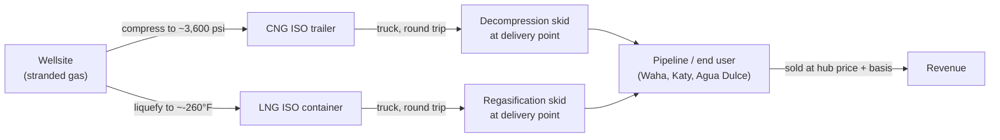

# 01 — The virtual-pipeline value chain and the netback formula

## The problem in one paragraph

In the Permian and Eagle Ford, oil wells also produce gas (**associated gas**, gas that
comes out of the ground with the oil). If no gathering pipeline has reached the pad yet, or
the pipeline is full, the operator has three choices: **flare** it (burn it on site, earning
$0), **shut in** the well (stop producing, which also stops the *oil* revenue), or put the gas
on a truck. A **virtual pipeline** is the truck option. Gas is compressed (CNG) or liquefied
(LNG) into ISO containers, hauled by road to a point where it can be sold, and turned back into
pipeline-pressure gas there. This project asks one question for each site and each day: **after
paying for the whole chain, what does the producer net per MMBtu, and does that beat flaring?**

## The chain



| Term | Plain meaning |
|---|---|
| **MMBtu** | One million British thermal units. It measures *energy*. Gas is bought and sold per MMBtu. |
| **Mcf** | One thousand cubic feet. It measures *volume*. Producers report output in Mcf/d or MMcf/d (MMSCFD). |
| **Henry Hub** | A pipeline interconnect in Erath, Louisiana. It is the delivery point for the NYMEX gas futures contract, so it serves as the US benchmark price. |
| **Basis** | Local price minus the Henry Hub price. Negative basis means gas is worth less at that location, usually because pipelines out of the area are full. |
| **Waha** | The main Permian pricing hub (Pecos County, TX). Takeaway pipelines out of the Permian are tight, so Waha trades at a deep discount to Henry Hub and at times has gone below $0. |
| **Katy / Houston Ship Channel** | Gulf Coast hubs near Houston, where industrial and LNG-export demand sits. Prices there are usually close to Henry Hub. |
| **Agua Dulce** | A South Texas hub near the Eagle Ford. It feeds Mexico exports and Corpus Christi LNG. |
| **CNG** | Compressed natural gas, about 3,000–4,500 psi in tube trailers. Cheap to make, but each trailer carries relatively little energy. |
| **LNG** | Liquefied natural gas, cooled to about −260 °F so it occupies roughly 1/600 of its gas volume. Expensive to make (liquefaction), but each load carries far more energy. |
| **Decompression / regas** | Reversing the process at the delivery point: letting CNG down to pipeline pressure (with heating), or warming LNG back into gas. |
| **Netback** | The price the producer receives *at the wellhead*: the sale price minus every cost of getting the gas from the wellhead to the buyer. |

## The netback formula

All terms are in **$/MMBtu**, so they can be added together.

```
netback(site, hub, mode, day) =
      delivered_price(hub, day)                      -- Henry Hub(day) + basis(hub)
    − conditioning(mode)                             -- compression (CNG) or liquefaction (LNG)
    − trucking(site, hub, mode, diesel_week)         -- round-trip fuel + non-fuel $/mile, per MMBtu carried
    − delivery(mode)                                 -- decompression (CNG) or regas (LNG)
    − fees                                           -- marketing / injection / tariff
```

Trucking is the only term that depends on distance and diesel price, so it is the one that makes
location matter:

```
trucking ($/MMBtu) = round_trip_miles × ( diesel $/gal ÷ mpg  +  non_fuel $/mile )
                     ───────────────────────────────────────────────────────────
                                    MMBtu delivered per load
```

The **decision rule** follows from the formula. Trucking wins if `netback > 0`, because flaring
earns $0. Choose the hub and mode with the highest netback. The **break-even distance** is the
one-way mileage at which `netback = 0`. Every term except trucking is a constant per MMBtu, so
the break-even mileage can be solved in closed form:

```
break_even_one_way_miles = (delivered_price − conditioning − delivery − fees) × MMBtu_per_load
                           ─────────────────────────────────────────────────────────────────────
                                    2 × ( diesel $/gal ÷ mpg + non_fuel $/mile )
```

## Why CNG vs LNG is a distance question

CNG is cheap to produce but carries little energy per load, so its **fixed cost is low and its
per-mile cost is high**. LNG is the reverse: liquefaction is expensive, but each container holds
several times more MMBtu, so the per-mile cost is much lower. Plot netback against distance and
you get two downward-sloping lines. CNG starts higher and falls faster. **They cross at some
distance. Below it, CNG wins; above it, LNG wins.** This project computes that crossover from
data instead of asserting it.

## Unit conversions (sourced constants, not assumptions)

| Conversion | Value | Source |
|---|---|---|
| Heat content of US natural gas | **1,037 Btu/cf → 1 Mcf = 1.037 MMBtu** (2025 avg, delivered to end users) | [EIA FAQ #45](https://www.eia.gov/tools/faqs/faq.php?id=45&t=8) |
| $/Mcf from $/MMBtu | `$/Mcf = $/MMBtu × 1.037` | derived |
| Site volume | `1 MMSCFD ≈ 1,037 MMBtu/day` | derived |
| LNG energy per pound (HHV) | **23,726 Btu/lb** | [AFDC fuel properties](https://afdc.energy.gov/fuels/properties) |
| CNG energy per pound (HHV) | **22,453 Btu/lb** | AFDC fuel properties |
| Diesel energy (HHV) | **138,490 Btu/gal** | AFDC fuel properties |

Gas is traded on a **higher heating value (HHV)** basis: the energy count includes the heat
recovered by condensing the water vapor in the exhaust. All constants here are therefore HHV.
Mixing HHV and LHV is a common, silent ~10% error.

## What "flaring vs. shut-in" means in this model

- **Flare:** gas revenue is $0. Netback > 0 means trucking is strictly better. The model does
  not monetize regulatory or emissions cost; a sensitivity scenario could add it.
- **Shut-in:** for associated gas, shutting in the gas also shuts in the oil, so the true cost is
  the lost oil margin. This project treats that as out of scope and states it as a limitation:
  it is a gas-netback model, not a full well-economics model.
