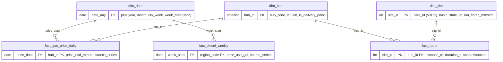

# 03 — Star schema

## Design choices

| Choice | Why |
|---|---|
| **Three facts with three different grains** (day×hub, week×region, site×hub) | Each fact is stored at the grain its source publishes. Mixing grains in one table means repeating weekly values on every day, which then go stale silently. The view `v_netback_daily` joins them, and is the one place where grains are reconciled. |
| `dim_date` as a natural `date` key, generated for 2010–2030 | A `date` is already a perfect, readable key. A surrogate integer adds nothing here. Pre-generating the range means a foreign key on `dim_date` also catches bad periods from the API. |
| `week_start` = ISO Monday | EIA dates its weekly diesel survey on Mondays, so `dim_date.week_start` maps any day to its diesel week. The netback view still uses an *as-of* join (latest week ≤ day) so a delayed release doesn't drop days. |
| `fact_gas_price_daily` keyed by `hub_id`, even though only Henry Hub has data | Regional hub prices are licensed (see [02](02-data-sources.md)). If they are ever bought, they drop in as new rows with no schema change. Today, delivered price is Henry Hub plus an assumed basis. |
| **Constraints for the impossible, DQ for the implausible** | `CHECK (diesel > 0)` rejects bad data at write time. Gas prices have no lower bound because negative Waha prices are real. Out-of-range values are flagged in `ops.dq_results` rather than rejected. |
| `distance_mi` / `duration_hr` as **generated columns** | The raw OSRM metres and seconds are kept, and the units shown in dashboards are derived in exactly one place. |
| Snap distances on `fact_route` | Flares sit on pads off lease roads. If OSRM moved a point 9 km to reach a road, the route is suspect, and DQ should say so. |
| Schemas `core` / `ops` / `mart` | Ingestion writes `core`. Pipeline metadata lives in `ops`. Dashboards read only `mart`, so tables can be refactored without breaking dashboards. |
