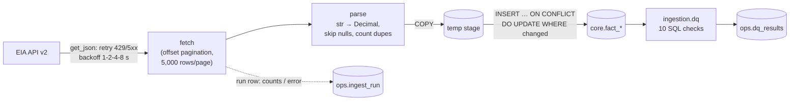

# 04 — Ingestion and data quality

`make pipeline` = `migrate → ingest → dq`. It exits non-zero on any failed load or any failed
`error`-severity check, so a scheduler or CI treats a bad feed as a failed job.

## Design choices

| Choice | Why |
|---|---|
| **Overlap window** (re-pull the last 30 days on every run) | Incremental and cheap: about 22 rows instead of 4,243. It still catches EIA revisions, which show up as `rows_updated` instead of being silently overwritten. `--full` re-pulls everything from 2010. |
| **Stage + set-based upsert** | `COPY` into a temp table, then a single `INSERT … ON CONFLICT DO UPDATE`. `WHERE old IS DISTINCT FROM new` means unchanged rows are not rewritten, so a re-run reports `inserted=0 updated=0` and is provably idempotent. |
| **One transaction per series**; run log on a **separate autocommit connection** | A failed series rolls back cleanly, but the record that it failed survives the rollback. |
| Retries only on 429 / 5xx / network errors | A 403 (bad key) or 400 (bad series) will not fix itself, so retrying only delays the alert. |
| Errors never include the URL | EIA requires the key in the query string. `requests` exceptions include the full URL, so the code logs only the exception type and status. A test asserts this, and the bad-key run was checked: the stored error contains no key. |
| `Decimal`, not `float` | EIA sends `"3.1"` as text. Parsing it straight to `Decimal` → `numeric` avoids binary rounding before the value is stored. |

## Data-quality checks

Each check is a SQL query returning `(observed, details)`. A check passes when
`observed ≤ threshold`. `error` checks block the pipeline; `warn` checks only record a result.
**Thresholds come from profiling the real 2010–2026 history**, not from guesses:

| Check | Severity | Threshold | Calibration evidence |
|---|---|---|---|
| `gas_feed_stale_days` | error | 10 days | EIA releases the daily Henry Hub series **weekly** (Wednesday, data through Tuesday), so normal lag peaks at 8 days. |
| `diesel_feed_stale_days` | error | 10 days | Monday survey, published the same day (Tuesday after a holiday). |
| `gas_missing_weekdays_90d` | warn | 8 | Worst trailing-90-day count, 2010–2026: **8**. Recent EIA data fills holidays by carrying the prior price forward (2026-07-03 = 2026-07-02 = $3.34). |
| `diesel_missing_weeks` | error | 0 | 877 consecutive Monday weeks since 2010, no gaps, in both regions. |
| `gas_price_out_of_range_30d` | warn | 0 outside $0–40 | Henry Hub has never printed below $0. Its max is **$30.72 on 2026-01-23** (January 2026 cold snap), above Uri's $23.86 (2021-02-17). |
| `gas_daily_jump_30d` | warn | 0 moves > 50% | Largest day-over-day move: **+319%** (Jan 2026). These are real, but rare enough that a human should look. |
| `diesel_price_out_of_range` | error | 0 outside $1–10 | Range 2010–2026: $1.86–$6.53. Outside $1–10 means a unit or parsing error. |
| `diesel_weekly_jump_8w` | warn | 0 moves > 20% | Max week-over-week: 28.6%; 99.9th percentile: ~22%. |
| `ingest_duplicate_periods` | warn | 0 | The primary key makes table duplicates impossible; this catches duplicates *in the payload*. |
| `ingest_latest_run_failed` | error | 0 | Latest run per source. Verified: a run with an invalid key fails all 3 sources and this check blocks. |

Real data quirks the code handles: **2018-01-05 Henry Hub is `null`** (bomb-cyclone week) and is
skipped. EIA sends values as strings.

## Scheduling

- **GitHub Actions** (`.github/workflows/pipeline.yml`): every push runs lint + tests against a
  throwaway Postgres. On weekdays at 14:00 UTC, a `refresh` job runs the live pipeline into a
  fresh database and uploads `ingest_run.csv` and `dq_latest.csv` as artifacts. It acts as a
  **canary on the upstream feed**: if EIA renames a series, goes stale or sends bad values, the
  job fails and GitHub emails the owner. Needs the repo secret `EIA_API_KEY`.
- **Local** (the database that feeds the dashboard): `crontab -e` and add
  `0 9 * * 1-5 cd "<repo path>" && make pipeline >> pipeline.log 2>&1`.
