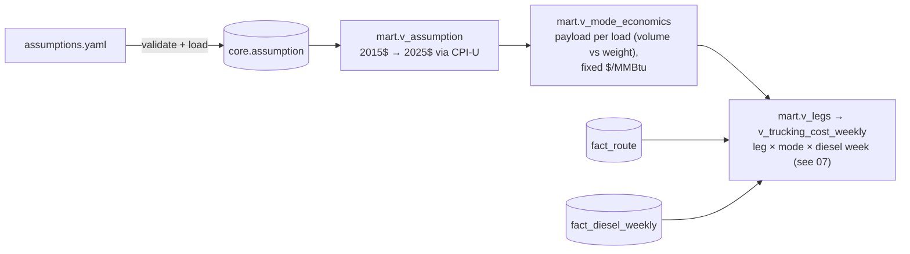

# 06 — Trucking cost model and assumptions

All arithmetic lives in three SQL views (`sql/migrations/006_assumptions_and_trucking.sql`).
`assumptions.yaml` is the single place every non-market number is set. `make assumptions`
validates it and loads it into `core.assumption`.



## The model

```
round_trip_mi     = 2 × (OSRM road miles + snap distance to nearest mapped road × last_mile_factor)
usd_per_mile      = diesel $/gal (EIA PADD 3, that week) ÷ mpg + non-fuel $/mile (ATRI)
trucking $/MMBtu  = fixed transport $/MMBtu + round_trip_mi × usd_per_mile ÷ net MMBtu per load
```

**Payload is computed, not assumed.** Each truckload is the smaller of what the container
holds and what is legal under the 80,000 lb federal gross weight limit, after subtracting the tractor,
chassis and empty container:

| Mode | Container | Volume limit | Weight limit | Binds | Net per load |
|---|---|---|---|---|---|
| CNG | Hexagon TITAN4 40 ft, 363,148 scf | 376.6 MMBtu | 445.3 MMBtu | volume | **338.9 MMBtu** (90% deliverable) |
| LNG | 40 ft T75 cryogenic ISO, 12,020 gal | 898.3 MMBtu | 619.3 MMBtu | **weight** | **606.9 MMBtu** (98% deliverable) |

An LNG ISO tank on a road chassis reaches 80,000 lb at about 69% full, so its theoretical
2.4× energy advantage over CNG shrinks to **1.8×**. The larger Hexagon TITAN XL
(525,350 scf) is excluded because it weighs 71,114 lb *before* a tractor is attached.

## Calibration against an independent benchmark

The World Bank's GGFR studies (2016) estimate full-chain costs for trucking small volumes of
associated gas. Their *stage* costs (treatment, compression or liquefaction, delivery) feed this
model. Their *transport* costs do not: trucking is rebuilt bottom-up from 2025 diesel, ATRI and
container specs. Then the totals are compared:

| Full chain excluding gas, routes under 250 mi, diesel week 2026-10-19 | This model | GGFR 0–250 mi, 3 MMscf/d (2025$) |
|---|---|---|
| CNG | $5.69/MMBtu | $5.23/MMBtu |
| LNG | $11.34/MMBtu | $11.03/MMBtu |

The two independent methods land within 3–9% of each other. The model runs slightly high
because US-legal payloads are smaller than GGFR's generic trailers, and 2026 diesel is expensive
($5.90/gal in PADD 3).

## Assumptions

25 sourced, 3 derived, 10 rough estimates. Costs given in 2015 dollars are escalated by
CPI-U 2025/2015 = 321.943 / 237.017 = **1.358**. This table is generated by
`python -m ingestion.assumptions --markdown`.

| Assumption | Value | Range (sensitivity) | Unit | Basis | Source |
|---|---|---|---|---|---|
| `basis_waha` | -2.07 | -2.37 – -0.42 | usd_per_mmbtu | sourced | [EIA Today in Energy, 2024-09-10: Waha averaged $2.07/MMBtu below Henry Hub in 2024 to date (NGI data)](https://www.eia.gov/todayinenergy/detail.php?id=63044) |
| `basis_agua_dulce` | -0.4 | -0.6 – -0.2 | usd_per_mmbtu | **rough estimate** | [No public daily series. NGI trade press (paywalled, unverified) reports Agua Dulce 25-49 cents under Henry Hub in 2025-26 spot and forward markets.](https://www.naturalgasintel.com/services/ngi-price-index-data/) |
| `basis_katy` | -0.3 | -1 – -0.1 | usd_per_mmbtu | **rough estimate** | [No public daily series. Trade press (unverified): Katy usually under $0.20 below Henry Hub, about $1 below during the 2022-23 Freeport LNG outage, ~47 cents below in winter 2026/27 forwards.](https://www.ice.com/products/59293792/Katy-Basis-Future) |
| `gas_mmbtu_per_mcf` | 1.037 |  | mmbtu_per_mcf | sourced | [EIA FAQ 45: 2025 average heat content of natural gas delivered to end users, 1,037 Btu/cf](https://www.eia.gov/tools/faqs/faq.php?id=45&t=8) |
| `lng_btu_per_lb` | 23726 |  | btu_per_lb | sourced | [DOE AFDC fuel properties: LNG higher heating value](https://afdc.energy.gov/fuels/properties) |
| `lng_lb_per_gal` | 3.5 |  | lb_per_gal | derived | [DOE AFDC: 1 lb LNG = 0.19 GGE and 1 GGE = 1.5 gal LNG, so 1/0.19/1.5 = 3.5 lb/gal](https://afdc.energy.gov/fuels/natural-gas-basics) |
| `gas_lhv_btu_per_lb` | 20160 |  | btu_per_lb | sourced | [DOE AFDC fuel properties: CNG lower heating value](https://afdc.energy.gov/fuels/properties) |
| `gas_hhv_btu_per_lb` | 22453 |  | btu_per_lb | sourced | [DOE AFDC fuel properties: CNG higher heating value. Gas is sold on HHV, engines burn on LHV.](https://afdc.energy.gov/fuels/properties) |
| `diesel_lhv_btu_per_gal` | 128488 |  | btu_per_gal | sourced | [DOE AFDC fuel properties: low-sulfur diesel lower heating value](https://afdc.energy.gov/fuels/properties) |
| `gross_vehicle_weight_limit_lb` | 80000 |  | lb | sourced | [23 CFR 658.17(b): maximum gross vehicle weight 80,000 lb on the Interstate System](https://www.law.cornell.edu/cfr/text/23/658.17) |
| `tractor_and_chassis_lb` | 27000 | 25000 – 30000 | lb | **rough estimate** | Day-cab tractor plus 40 ft container chassis. Consistent with Hexagon selling the TITAN4 (50,024 lb loaded) as US road-legal, which leaves at most 29,976 lb for tractor and chassis. |
| `cng_capacity_scf` | 363148 | 363148 – 492180 | scf | sourced | [Hexagon Agility Mobile Pipeline brochure (2021): TITAN4 40 ft nominal capacity 363,148 scf at 15 C](https://www.cngservices.co.uk/wp-content/uploads/MobilePipleline_ePub_2021_11x8.5_b.pdf) |
| `cng_container_tare_lb` | 33700 |  | lb | sourced | [Hexagon Mobile Pipeline brochure (2021): TITAN4 40 ft net container weight 33,700 lb](https://www.cngservices.co.uk/wp-content/uploads/MobilePipleline_ePub_2021_11x8.5_b.pdf) |
| `cng_lb_per_scf` | 0.04495 |  | lb_per_scf | sourced | [Hexagon Mobile Pipeline brochure (2021): CNG gas weight 0.04495 lb/scf](https://www.cngservices.co.uk/wp-content/uploads/MobilePipleline_ePub_2021_11x8.5_b.pdf) |
| `cng_deliverable_fraction` | 0.9 | 0.85 – 0.96 | fraction | sourced | [World Bank GGFR, CNG for commercialization of small volumes of associated gas (2016): residual gas 10-15% with conventional high-pressure blowdown](https://documents1.worldbank.org/curated/en/210571472125529218/pdf/104200-V2-WP-CNG-commercialization-PUBLIC-Main-report-REPLACEMENT.pdf) |
| `lng_capacity_gal` | 12020 |  | gal | sourced | [OEG cryogenic ISO tank datasheet: 40 ft T75, 12,020 US gal (45,500 L)](https://www.oeg.group/hubfs/data-sheets/OEG-Datasheet-Cryogenic-ISO-tanks.pdf) |
| `lng_max_fill_fraction` | 0.9 |  | fraction | **rough estimate** | Cryogenic tanks keep vapour space for boil-off. Does not bind: at 80,000 lb the load is weight-limited well below this fill. |
| `lng_container_tare_lb` | 26898 |  | lb | sourced | [OEG cryogenic ISO tank datasheet: 40 ft T75 tare 26,898 lb](https://www.oeg.group/hubfs/data-sheets/OEG-Datasheet-Cryogenic-ISO-tanks.pdf) |
| `lng_deliverable_fraction` | 0.98 | 0.95 – 1 | fraction | **rough estimate** | A small liquid heel is usually kept to hold the tank cold for the return trip; boil-off on a same-day haul is small. |
| `truck_mpg` | 6.3 | 5.3 – 7.3 | mi_per_gal | sourced | [DOE AFDC average fuel economy, Class 8 truck: 6.3048 mpg (FHWA Highway Statistics 2024, Table VM-1)](https://afdc.energy.gov/data/10310) |
| `nonfuel_usd_per_mile` | 1.854 | 1.483 – 2.225 | usd_per_mile (2025$) | sourced | [ATRI, An Analysis of the Operational Costs of Trucking (2026, 2025 data): $2.336/mi total, $1.854/mi excluding fuel](https://www.ttnews.com/articles/atri-truck-costs-2025) |
| `last_mile_factor` | 1 | 1 – 1.5 | ratio | **rough estimate** | Multiplier on the straight-line gap between a flare and the nearest mapped road (OSRM snap distance). 1.0 is a lower bound; lease roads wind. |
| `route_distance_factor` | 1 | 0.75 – 1.25 | ratio | **rough estimate** | Multiplier on routed hub miles. Below 1: the gas is delivered to a nearer pipeline interconnect than the named hub; above 1: detours, permitted truck routes. |
| `diesel_region` | PADD3 |  | region_code | sourced | EIA weekly No. 2 diesel retail, Gulf Coast (PADD 3): Texas and New Mexico are both in PADD 3 |
| `cng_gas_treatment` | 0.42 | 0.21 – 0.55 | usd_per_mmbtu (2015$) | sourced | [World Bank GGFR CNG report (2016), onshore truck 3 MMscf/d: gas treatment 0.42 USD2015/MMBtu](https://documents1.worldbank.org/curated/en/210571472125529218/pdf/104200-V2-WP-CNG-commercialization-PUBLIC-Main-report-REPLACEMENT.pdf) |
| `cng_compression` | 0.73 | 0.7 – 0.95 | usd_per_mmbtu (2015$) | sourced | [World Bank GGFR CNG report (2016), onshore truck 3 MMscf/d: compression/loading 0.73 USD2015/MMBtu](https://documents1.worldbank.org/curated/en/210571472125529218/pdf/104200-V2-WP-CNG-commercialization-PUBLIC-Main-report-REPLACEMENT.pdf) |
| `cng_delivery` | 0.5 | 0.5 – 0.65 | usd_per_mmbtu (2015$) | sourced | [World Bank GGFR CNG report (2016): delivery (offloading, heating, let-down, metering) 0.50 USD2015/MMBtu](https://documents1.worldbank.org/curated/en/210571472125529218/pdf/104200-V2-WP-CNG-commercialization-PUBLIC-Main-report-REPLACEMENT.pdf) |
| `cng_fixed_transport` | 1.1 | 0.8 – 1.43 | usd_per_mmbtu (2015$) | derived | [Intercept of GGFR's CNG truck transport cost vs distance: 2.20 at 0-250 mi and 8.81 at 750-1000 mi, so slope 0.00881/mi and intercept 2.20 - 125 x 0.00881 = 1.10 USD2015/MMBtu](https://documents1.worldbank.org/curated/en/210571472125529218/pdf/104200-V2-WP-CNG-commercialization-PUBLIC-Main-report-REPLACEMENT.pdf) |
| `lng_gas_treatment` | 0.42 | 0.21 – 0.55 | usd_per_mmbtu (2015$) | sourced | [World Bank GGFR mini/micro-LNG report (2016), onshore truck 3 MMscf/d: gas treatment 0.42 USD2015/MMBtu](https://documents1.worldbank.org/curated/en/299861484716073109/pdf/112131-WP-MiniMicroLNGforcommercializationofsmallvolumesofassociatedgas-PUBLIC-v2.pdf) |
| `lng_liquefaction` | 4.71 | 3.71 – 6.12 | usd_per_mmbtu (2015$) | sourced | [World Bank GGFR mini/micro-LNG report (2016), onshore truck 3 MMscf/d: liquefaction 4.71 USD2015/MMBtu](https://documents1.worldbank.org/curated/en/299861484716073109/pdf/112131-WP-MiniMicroLNGforcommercializationofsmallvolumesofassociatedgas-PUBLIC-v2.pdf) |
| `lng_delivery` | 1.56 | 1.06 – 2.03 | usd_per_mmbtu (2015$) | sourced | [World Bank GGFR mini/micro-LNG report (2016), onshore truck 3 MMscf/d: delivery (regasification) 1.56 USD2015/MMBtu](https://documents1.worldbank.org/curated/en/299861484716073109/pdf/112131-WP-MiniMicroLNGforcommercializationofsmallvolumesofassociatedgas-PUBLIC-v2.pdf) |
| `lng_fixed_transport` | 0.85 | 0.6 – 1.1 | usd_per_mmbtu (2015$) | derived | [Intercept of GGFR's LNG truck transport cost vs distance: 1.43 at 0-250 mi and 4.93 at 750-1000 mi, so slope 0.00467/mi and intercept 1.43 - 125 x 0.00467 = 0.85 USD2015/MMBtu](https://documents1.worldbank.org/curated/en/299861484716073109/pdf/112131-WP-MiniMicroLNGforcommercializationofsmallvolumesofassociatedgas-PUBLIC-v2.pdf) |
| `marketing_fee` | 0.1 | 0 – 0.25 | usd_per_mmbtu | **rough estimate** | Marketing, scheduling and interconnect fees at the delivery point. No public benchmark for virtual-pipeline volumes. |
| `fuel_discount_to_diesel` | 0.4 | 0.2 – 0.6 | fraction | **rough estimate** | Share of diesel-parity value given up to win the customer: covers their dual-fuel conversion, substitution limits, and the fact that off-road diesel is untaxed. |
| `fuel_customer_one_way_mi` | 50 | 10 – 150 | mi | **rough estimate** | Typical haul from a flaring pad to a rig or frac fleet in the same basin. Customer locations are not public, so this is a single adjustable distance, not a routed one. |
| `lng_delivery_as_fuel` | 0.2 | 0.2 – 0.26 | usd_per_mmbtu (2015$) | sourced | [World Bank GGFR, Comparison of mini-micro LNG and CNG (2016): delivery of LNG in liquid form 0.2 USD/MMBtu (vs 0.5-1.5 regasified)](https://documents1.worldbank.org/curated/en/795991484736761603/pdf/112132-WP-ComparisonofMiniLNGandCNGforcommercializingsmallvolumesofassociatedgas-PUBLIC-v2.pdf) |
| `cpi_u_2015` | 237.017 |  | index | sourced | [BLS CPI-U all items (CUUR0000SA0), 2015 annual average](https://data.bls.gov/timeseries/CUUR0000SA0) |
| `cpi_u_2025` | 321.943 |  | index | sourced | [BLS CPI-U all items (CUUR0000SA0), 2025 annual average](https://data.bls.gov/timeseries/CUUR0000SA0) |

## Simplifications (stated, not hidden)

- **Non-fuel costs are held at 2025 levels across history.** Diesel and gas move weekly and
  daily. A historical netback therefore isolates *market* moves, not cost inflation.
- **Retail diesel**, taxes included. Fleets with fuel cards pay somewhat less.
- **OSRM car-profile durations** are context only. Cost is per mile.
- **GGFR's smallest scenario is 3 MMscf/d.** These sites flare 0.24–1.93 MMscf/d, so real unit
  costs are likely higher. The sensitivity range runs to +30%.
