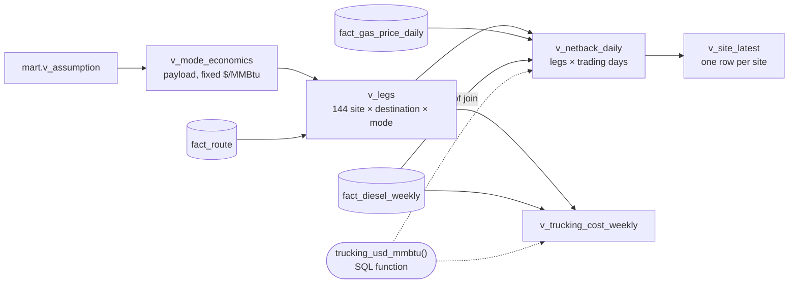

# 07 — The netback view

`mart.v_netback_daily` gives one row per **trading day × site × option**: 4,242 days × 18 sites × 8
options = 610,848 rows. Every number is plain SQL over the star schema and `core.assumption`.

## Options compared for every site, every day

| Market | Modes | Delivered price | Delivery cost |
|---|---|---|---|
| **Pipeline hub**: Waha, Agua Dulce, Katy | CNG, LNG | Henry Hub (EIA, daily) + basis | decompression (CNG) or regasification (LNG) |
| **In-basin fuel customer**: rig, frac fleet, off-grid power | CNG, LNG | diesel parity (EIA PADD 3, weekly) × (1 − discount) | let-down (CNG) or liquid hand-off (LNG) |
| **Flare** (the baseline) | – | $0 | – |

**Diesel parity on the right heating value.** Engines burn fuel on its lower heating value (LHV), but gas is
sold per HHV MMBtu. One gallon of diesel (128,488 Btu LHV) does the work of
128,488 ÷ (20,160 / 22,453) = 143,100 Btu of gas *as sold*. So:
`parity $/MMBtu = diesel $/gal ÷ 0.1431`. On 2026-10-20 that is $5.903/gal → **$41.250/MMBtu**.
A naive HHV-to-HHV comparison ($/gal ÷ 0.13849) gives $42.62, overstating the gas value
by 3.3%, because diesel keeps more of its energy on an LHV basis (0.928) than gas does (0.898).

**Closed-form break-evens**, computed in the view rather than by a solver:
- `break_even_one_way_mi`: margin left after every distance-independent cost × MMBtu per load ÷ (2 × $/mile), minus the last mile.
- `break_even_henry_hub`: total cost − basis.
- `break_even_fuel_discount`: 1 − total cost ÷ diesel parity.

## Result on 2026-10-20 (Henry Hub $3.100/MMBtu)

| Site | MMSCFD | Best option | Netback $/MMBtu | $M/yr vs flaring | Best hub option | Hub netback | Hub break-even HH | Fuel break-even discount |
|---|---|---|---|---|---|---|---|---|
| PB-01 | 1.93 | CNG → fuel customer | **20.09** | 14.7 | CNG → Waha | -4.20 | 7.30 | 89% |
| PB-02 | 1.92 | CNG → fuel customer | **20.09** | 14.6 | CNG → Waha | -5.16 | 8.26 | 89% |
| PB-03 | 1.87 | CNG → fuel customer | **20.09** | 14.2 | CNG → Waha | -4.74 | 7.84 | 89% |
| PB-04 | 1.84 | CNG → fuel customer | **20.07** | 14.0 | CNG → Waha | -3.60 | 6.70 | 89% |
| PB-05 | 1.60 | CNG → fuel customer | **20.09** | 12.2 | CNG → Waha | -4.62 | 7.72 | 89% |
| PB-06 | 1.37 | CNG → fuel customer | **20.09** | 10.5 | CNG → Waha | -4.49 | 7.59 | 89% |
| PB-07 | 1.32 | CNG → fuel customer | **20.09** | 10.0 | CNG → Waha | -3.76 | 6.86 | 89% |
| PB-08 | 1.26 | CNG → fuel customer | **20.09** | 9.6 | CNG → Waha | -5.06 | 8.16 | 89% |
| PB-09 | 1.23 | CNG → fuel customer | **20.08** | 9.3 | CNG → Waha | -4.70 | 7.80 | 89% |
| PB-10 | 1.06 | CNG → fuel customer | **20.09** | 8.0 | CNG → Waha | -3.65 | 6.75 | 89% |
| PB-11 | 1.01 | CNG → fuel customer | **20.01** | 7.6 | CNG → Waha | -3.98 | 7.08 | 88% |
| PB-12 | 0.94 | CNG → fuel customer | **20.09** | 7.1 | CNG → Waha | -4.74 | 7.84 | 89% |
| EF-01 | 0.93 | CNG → fuel customer | **20.09** | 7.1 | CNG → Agua Dulce | -2.76 | 5.86 | 89% |
| EF-02 | 0.71 | CNG → fuel customer | **20.09** | 5.4 | CNG → Agua Dulce | -2.60 | 5.70 | 89% |
| EF-03 | 0.60 | CNG → fuel customer | **20.09** | 4.5 | CNG → Agua Dulce | -3.25 | 6.35 | 89% |
| EF-04 | 0.38 | CNG → fuel customer | **20.09** | 2.9 | CNG → Agua Dulce | -2.70 | 5.80 | 89% |
| EF-05 | 0.33 | CNG → fuel customer | **20.07** | 2.5 | CNG → Agua Dulce | -3.26 | 6.36 | 89% |
| EF-06 | 0.24 | CNG → fuel customer | **20.09** | 1.8 | CNG → Agua Dulce | -3.23 | 6.33 | 89% |

How to read it:
1. **Selling into a pipeline loses money at every site** at today's prices. The Permian is
   worse, because its only nearby hub, Waha, is the discounted one. Break-even Henry Hub ranges
   from $5.70 (Eagle Ford) to $8.26 (Permian).
2. **Selling the same gas as a diesel substitute nets about $20/MMBtu.** That holds up even
   though the discount is a rough estimate: the customer could demand **89% off diesel parity**
   before flaring would win. The open business question isn't price. It is whether there's a
   customer, and how much fuel they burn.
3. **CNG beats LNG everywhere here.** LNG's liquefaction cost (about $7/MMBtu at this scale)
   outweighs its payload advantage on routes this short.

## Has hub sales ever paid? (best hub option, share of trading days with netback > 0)

| Year | Avg Henry Hub | Eagle Ford | Permian |
|---|---|---|---|
| 2010 | $4.37 | 5.0% | 0.4% |
| 2011 | $4.00 | 0.0% | 0.0% |
| 2012 | $2.75 | 0.0% | 0.0% |
| 2013 | $3.73 | 0.0% | 0.0% |
| 2014 | $4.37 | 4.9% | 1.7% |
| 2015 | $2.62 | 0.0% | 0.0% |
| 2016 | $2.52 | 0.0% | 0.0% |
| 2017 | $2.99 | 0.0% | 0.0% |
| 2018 | $3.15 | 0.9% | 0.0% |
| 2019 | $2.56 | 0.0% | 0.0% |
| 2020 | $2.03 | 0.0% | 0.0% |
| 2021 | $3.89 | 5.5% | 1.2% |
| 2022 | $6.45 | 58.4% | 32.0% |
| 2023 | $2.53 | 0.0% | 0.0% |
| 2024 | $2.19 | 0.4% | 0.4% |
| 2025 | $3.52 | 1.3% | 0.6% |
| 2026 | $3.46 | 4.0% | 3.3% |

Only in **2022**, when Henry Hub averaged $6.45, did trucking to a hub beat flaring on most
Eagle Ford days. That matches the break-even Henry Hub of about $5.70–6.40 above.

## Caveats

- **Basis is held constant across history.** Waha's real discount ranged from about $0.42
  (H2 2021) to deeply negative (2024–26), so historical *Permian* hub results are indicative only.
- **Fuel demand is not capped.** $M/yr assumes a customer can take the site's whole flared
  volume. No public data gives rig or frac-fleet fuel demand by location.
- **Non-fuel costs are held at 2025 levels** (see 06). History isolates price moves, not cost
  inflation.

## Performance note

The first version joined a weekly trucking-cost view (126k rows) to the trading days. The
assumption pivots made Postgres underestimate rows (50 estimated vs 126,288 actual), so it chose a
nested loop that rescanned 4,242 days 126,288 times. Two fixes:
1. `ANALYZE` after every load, which took a full scan from 29 s to 0.9 s.
2. Restructuring to 144 legs × days with one shared trucking function, which took a yearly
   rollup from 24 s to 2.3 s.
